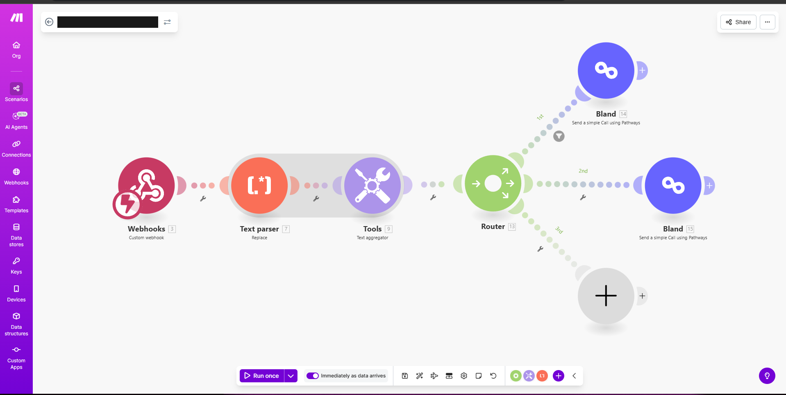

# Bland AI Bilingual Lead Callback

**Platform:** Make.com **Category:** AI Voice / Lead Follow-up

## Overview

Leads expect a fast callback in their own language. When a new lead comes in (e.g. from a chat or web form), this scenario immediately triggers a Bland AI phone call using a French or English conversation pathway, based on the lead's language.

## How It Works

1. Trigger — a custom webhook receives the lead (`name`, `phone`, `language`).
2. The phone number is cleaned to digits and formatted with the country code.
3. A router checks the language: French leads go to the French Bland pathway.
4. All other leads are called with the English Bland pathway.

## Tech Stack

Make.com, Bland AI

## Key Features

- Instant speed-to-lead: a call within seconds of the inquiry
- Language-based routing to separate conversation pathways
- Phone normalization for reliable dialing
- An open router branch is ready for more languages

## Setup

1. Import `blueprint.json` into a new Make scenario.
2. Connect: Bland AI.
3. Replace placeholders: `{{HOOK_ID}}`, `{{BLAND_CONNECTION_ID}}`, `{{BLAND_PATHWAY_ID_FRENCH}}`, `{{BLAND_PATHWAY_ID_ENGLISH}}`.

## Data Privacy

All personal, client, and employer data has been removed and replaced with placeholders. Company names, phone numbers, and email addresses that appear in this scenario are fictional and do not refer to real businesses or people.

---

Built by **Tahjib Hossain (Leon)**
