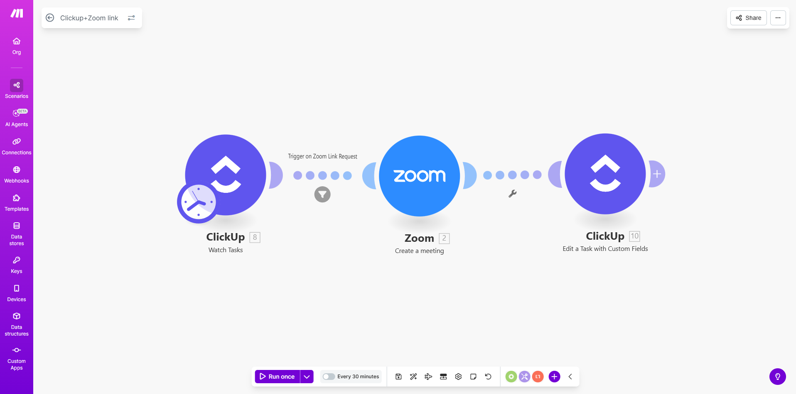

# ClickUp Task to Zoom Meeting Link

**Platform:** Make.com **Category:** Productivity / Project Management

## Overview

Creating a Zoom meeting and pasting the link into a task is repetitive busywork. With this scenario, ticking a **Generate Zoom Link** checkbox on a ClickUp task creates the meeting and writes the join link and password back into the task automatically.

## How It Works

1. Trigger — polls ClickUp (every 30 minutes) for changed tasks in the selected spaces.
2. A filter continues only when the task's `Generate Zoom Link` custom field is checked and the task type qualifies.
3. Zoom creates a scheduled meeting using the task name as the topic and the description as the agenda.
4. The ClickUp task is updated with the join URL and password, and its custom fields are reset.

## Tech Stack

Make.com, ClickUp, Zoom

## Key Features

- Checkbox-driven: no context switching for the team
- Filter prevents duplicate meetings and non-meeting task types
- Meeting details stored on the task for everyone to see

## Setup

1. Import `blueprint.json` into a new Make scenario.
2. Connect: ClickUp, Zoom.
3. Replace placeholders: `{{CLICKUP_TEAM_ID}}`, `{{CLICKUP_SPACE_ID_1}}`, `{{CLICKUP_SPACE_ID_2}}`, `{{CLICKUP_FOLDER_ID}}`, `{{CLICKUP_LIST_ID}}`, `{{CLICKUP_CONNECTION_ID}}`, `{{ZOOM_USER_CONNECTION_ID}}`. Re-select your own custom fields in the last module..

## Data Privacy

All personal, client, and employer data has been removed and replaced with placeholders. Company names, phone numbers, and email addresses that appear in this scenario are fictional and do not refer to real businesses or people.

---

Built by **Tahjib Hossain (Leon)**
