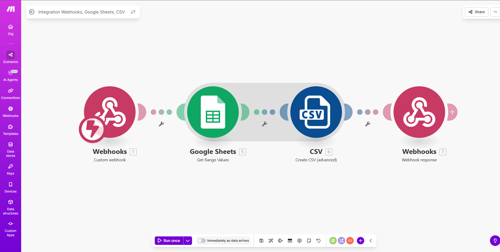

# Google Sheet to CSV Download Webhook

**Platform:** Make.com **Category:** Data Export / Utility

## Overview

Teams often need a live Google Sheet as a downloadable CSV for another tool, a script, or a client, without giving them sheet access. This scenario exposes the sheet through a webhook URL that returns a fresh CSV file on every request.

## How It Works

1. Trigger — a custom webhook URL is called (from a browser, script, or another app).
2. Google Sheets returns the configured range (with headers).
3. The rows are converted into a CSV file using a defined data structure.
4. The webhook responds with the CSV as a file download (`text/csv`, `SheetExport.csv`).

## Tech Stack

Make.com, Google Sheets, CSV

## Key Features

- Live data: every call exports the sheet's current state
- Shareable URL without sharing the spreadsheet itself
- Proper download headers so browsers save it as a file

## Setup

1. Import `blueprint.json` into a new Make scenario.
2. Connect: Google Sheets.
3. Replace placeholders: `{{HOOK_ID}}`, `{{SHEET_ID}}`, `{{GOOGLE_SHEETS_CONNECTION_ID}}`, `{{DATA_STRUCTURE_ID}}` (re-create the data structure to match your columns).

## Data Privacy

All personal, client, and employer data has been removed and replaced with placeholders. Company names, phone numbers, and email addresses that appear in this scenario are fictional and do not refer to real businesses or people.

---

Built by **Tahjib Hossain (Leon)**
