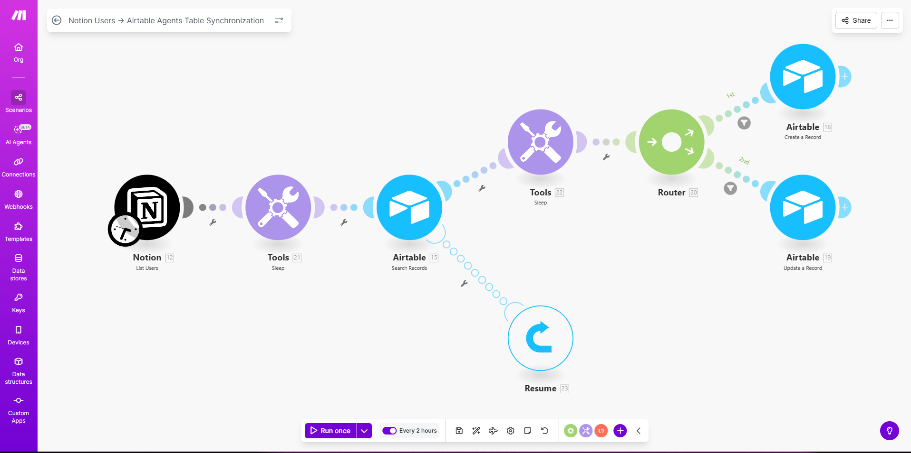

# Notion Users to Airtable Agents Sync

**Platform:** Make.com **Category:** Data Sync / Team Management

## Overview

When agents join or change in a Notion workspace, the Airtable roster used for lead assignment must stay in sync. This scenario keeps the Airtable `Agents` table matched to Notion users, so new team members start receiving leads without manual setup. It feeds [Real Estate Lead Round-Robin Assignment](../real-estate-lead-round-robin-assignment/).

## How It Works

1. Trigger — runs every 2 hours and lists all users in the Notion workspace.
2. Sleeps briefly between calls to respect API rate limits.
3. Searches the Airtable `Agents` table for each user's email (with a Resume error handler).
4. A router: if no match, it creates the agent with name, email, Notion user ID, and `Status = Available`.
5. If a match exists and the name changed, it updates the Airtable record.

## Tech Stack

Make.com, Notion, Airtable

## Key Features

- Upsert logic: create new agents, update changed ones
- Rate-limit friendly with built-in sleeps
- Error handler keeps the sync running on lookup failures
- Automatically enrolls new agents in the lead rotation

## Setup

1. Import `blueprint.json` into a new Make scenario.
2. Connect: Notion, Airtable.
3. Replace placeholders: `{{AIRTABLE_BASE_ID}}`, `{{AGENTS_TABLE_ID}}`, `{{NAME_FIELD_ID}}`, `{{STATUS_FIELD_ID}}`, `{{NOTION_USER_ID_FIELD_ID}}`, `{{NOTION_EMAIL_FIELD_ID}}`, `{{EMAIL_FIELD_ID}}`, and the `{{*_CONNECTION_ID}}` values.

## Data Privacy

All personal, client, and employer data has been removed and replaced with placeholders. Company names, phone numbers, and email addresses that appear in this scenario are fictional and do not refer to real businesses or people.

---

Built by **Tahjib Hossain (Leon)**
