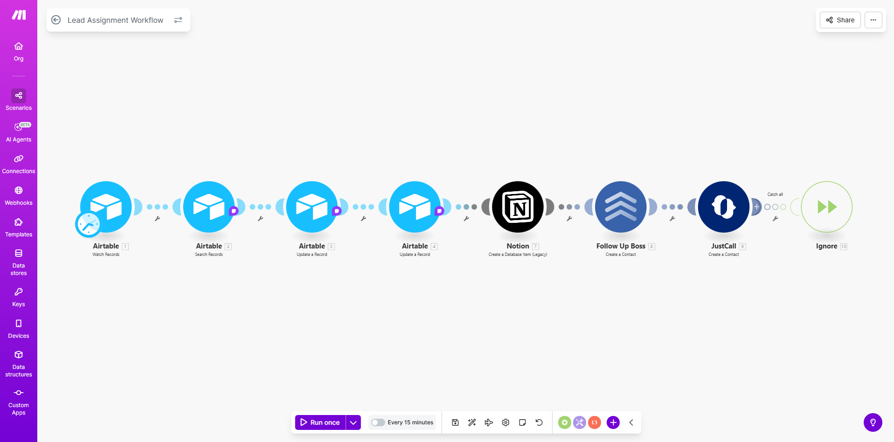

# Real Estate Lead Round-Robin Assignment

**Platform:** Make.com **Category:** Lead Management / CRM

## Overview

Real estate teams lose deals when new leads sit unassigned. This scenario assigns every new lead to the available agent who has been idle the longest, then creates the lead in the agent's Notion hub, Follow Up Boss, and JustCall automatically. It works with [Notion Users to Airtable Agents Sync](../notion-users-airtable-agents-sync/), which keeps the agent roster up to date.

## How It Works

1. Trigger — watches the Airtable `Leads` table (every 15 minutes) for new records.
2. Searches the `Agents` table for agents with `Status = Available`, sorted by `Last assigned at` (longest idle first).
3. Assigns that agent to the lead and stamps the agent's `Last assigned at` with the current time.
4. Creates a Notion database page for the lead, linked to the agent's Notion user.
5. Creates the contact in Follow Up Boss and JustCall, with an error handler so one failed app doesn't stop the run.

## Tech Stack

Make.com, Airtable, Notion, Follow Up Boss, JustCall

## Key Features

- Fair round-robin distribution based on idle time
- Single source of truth in Airtable, synced to 3 downstream tools
- Error handling on the dialer step
- In-scenario notes document each step

## Setup

1. Import `blueprint.json` into a new Make scenario.
2. Connect: Airtable, Notion, Follow Up Boss, JustCall.
3. Replace placeholders: `{{AIRTABLE_BASE_ID}}`, `{{LEADS_TABLE_ID}}`, `{{AGENTS_TABLE_ID}}`, `{{ASSIGNED_AGENT_FIELD_ID}}`, `{{LAST_ASSIGNED_AT_FIELD_ID}}`, `{{NOTION_DB_ID}}`, and the `{{*_CONNECTION_ID}}` values.

## Data Privacy

All personal, client, and employer data has been removed and replaced with placeholders. Company names, phone numbers, and email addresses that appear in this scenario are fictional and do not refer to real businesses or people.

---

Built by **Tahjib Hossain (Leon)**
