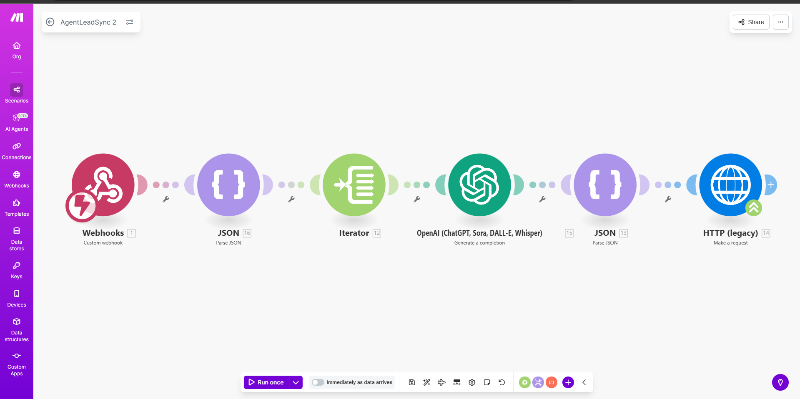

# Vapi Call Result AI Qualification

**Platform:** Make.com **Category:** AI Voice / Lead Qualification

## Overview

After an AI voice call, someone still has to read the transcript and decide whether the lead is worth pursuing. This scenario receives Vapi's call data, has OpenAI summarize and classify the lead, and pushes the result to your app or CRM. It's part 2 of the system that starts with [Vapi AI Outbound Calls from Google Drive CSV](../vapi-outbound-calls-from-drive-csv/).

## How It Works

1. Trigger — a custom webhook receives Vapi's server message (tool calls and call artifact).
2. Parses the JSON payload and iterates over the tool calls the agent made.
3. OpenAI (o4-mini, temperature 0) reads the full transcript and returns strict JSON: a 1–2 sentence `summary` and a `status` of `Qualified`, `Not Qualified`, or `Invalid`.
4. Parses the model's JSON response.
5. Posts `summary` and `status` to your backend endpoint to update the lead record.

## Tech Stack

Make.com, Vapi, OpenAI, HTTP

## Key Features

- Deterministic classification (temperature 0, strict JSON output, fixed status labels)
- Works with any backend or CRM through a simple form POST
- Real-time: runs immediately when Vapi sends the call data

## Setup

1. Import `blueprint.json` into a new Make scenario.
2. Connect: OpenAI.
3. Replace placeholders: `{{HOOK_ID}}`, `{{OPENAI_GPT_3_CONNECTION_ID}}`, and the `your-domain.com` endpoint URL.

## Data Privacy

All personal, client, and employer data has been removed and replaced with placeholders. Company names, phone numbers, and email addresses that appear in this scenario are fictional and do not refer to real businesses or people.

---

Built by **Tahjib Hossain (Leon)**
