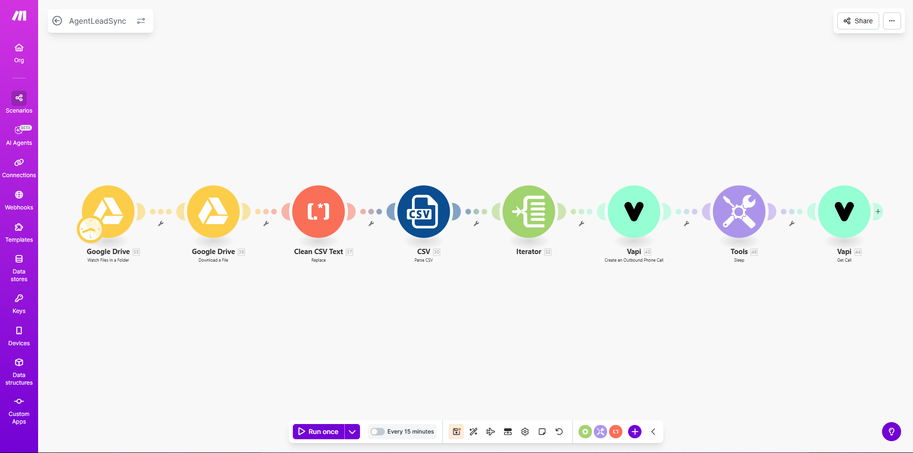

# Vapi AI Outbound Calls from Google Drive CSV

**Platform:** Make.com **Category:** AI Voice / Lead Management

## Overview

Calling a fresh lead list by hand is slow. Drop a CSV of leads into a Google Drive folder and this scenario has a Vapi AI voice agent call every lead automatically, then fetches each call's result. It's part 1 of a two-scenario system. Results are qualified by [Vapi Call Result AI Qualification](../vapi-call-result-ai-qualification/).

## How It Works

1. Trigger — watches a Google Drive folder (every 15 minutes) for newly created lead files.
2. Downloads the file and cleans it (tabs converted to commas) so exports from any tool parse correctly.
3. Parses the CSV (`full_name`, `phone`, `email`, `lead_status`) and iterates over the leads.
4. Vapi places an outbound call to each lead using the configured AI assistant and phone number.
5. Waits for the call to finish, then retrieves the call details (status, transcript, outcome).

## Tech Stack

Make.com, Google Drive, CSV, Vapi

## Key Features

- Zero-touch: uploading a CSV is the only manual step
- Text cleanup makes CSV parsing robust to tab-separated exports
- Built-in delay before fetching results, so completed call data is captured
- Pairs with an AI qualification scenario for end-to-end lead calling

## Setup

1. Import `blueprint.json` into a new Make scenario.
2. Connect: Google Drive, Vapi.
3. Replace placeholders: `{{DRIVE_FOLDER_ID}}`, `{{VAPI_ASSISTANT_ID}}`, `{{VAPI_PHONE_NUMBER_ID}}`, `{{GOOGLE_DRIVE_CONNECTION_ID}}`, `{{VAPI_CONNECTION_ID}}`.

## Data Privacy

All personal, client, and employer data has been removed and replaced with placeholders. Company names, phone numbers, and email addresses that appear in this scenario are fictional and do not refer to real businesses or people.

---

Built by **Tahjib Hossain (Leon)**
