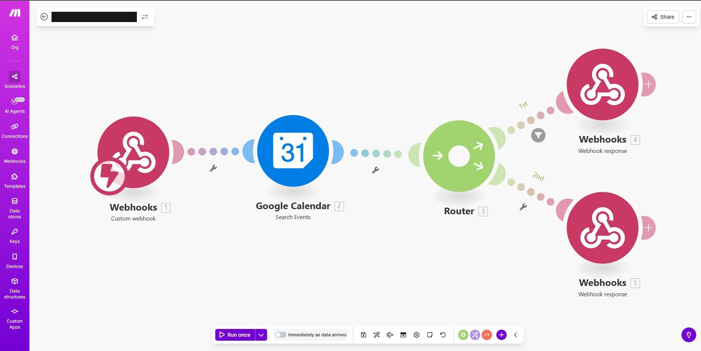

# Voice Agent Calendar Availability Check (Bland AI Tool)

**Platform:** Make.com **Category:** AI Voice / Appointment Booking

## Overview

An AI phone agent must never promise a time slot that's already taken. This scenario is a live tool for a Bland AI voice agent. During the call, the agent sends the requested date and time, and the scenario checks Google Calendar and answers available or not available in real time.

## How It Works

1. Trigger — a custom webhook receives `appointment_date` and `appointment_time` from the voice agent's tool call.
2. Parses the spoken date and time format (e.g. `Monday, March 3, 2025 2:00 PM`) and searches Google Calendar for events in that one-hour window.
3. A router checks the result: if an event exists, it responds `{ "available": false }`.
4. Otherwise it responds `{ "available": true }`, so the agent can confirm the booking.

## Tech Stack

Make.com, Bland AI, Google Calendar

## Key Features

- Synchronous webhook response, so the agent gets an answer mid-conversation
- Natural-language date parsing with Make's date functions
- Lightweight and reusable as a tool for any voice AI platform (Bland, Vapi, Retell)

## Setup

1. Import `blueprint.json` into a new Make scenario.
2. Connect: Google Calendar.
3. Replace placeholders: `{{HOOK_ID}}`, `{{GOOGLE_CALENDAR_CONNECTION_ID}}`, and the calendar ID (`user@example.com`).

## Data Privacy

All personal, client, and employer data has been removed and replaced with placeholders. Company names, phone numbers, and email addresses that appear in this scenario are fictional and do not refer to real businesses or people.

---

Built by **Tahjib Hossain (Leon)**
