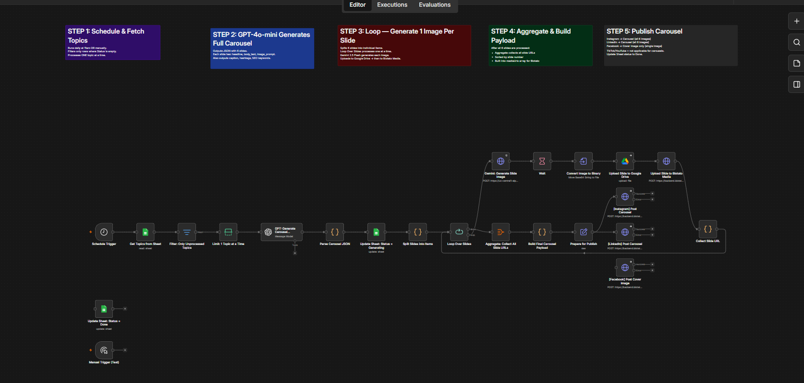

# AI Carousel Content Generator & Auto-Publisher

**Platform:** n8n **Category:** AI Content / Social Media Automation

## Overview

Designing educational carousels by hand takes hours per post. This workflow takes a topic from a Google Sheet, writes a complete carousel with GPT, generates a branded image for every slide with Gemini, and publishes it to Instagram, LinkedIn, and Facebook through Blotato.

## How It Works

1. Trigger — daily schedule (or manual run) reads topics from Google Sheets and picks one row whose status is empty.
2. GPT-4o-mini generates the carousel as JSON: slide headlines, body text, image prompts, caption, hashtags, and SEO keywords.
3. Slides are split into items and looped one by one. Gemini 2.5 Flash Image (Vertex AI) renders each slide.
4. Each image is uploaded to Google Drive and then to Blotato's media library.
5. Slide URLs are aggregated and sorted into the final media array.
6. The carousel posts to Instagram and LinkedIn, and the cover image posts to Facebook. The sheet row is then marked as done.

## Tech Stack

n8n, OpenAI (GPT-4o-mini), Google Vertex AI (Gemini 2.5 Flash Image), Google Sheets, Google Drive, Blotato

## Key Features

- End-to-end pipeline from topic to published multi-platform carousel, with no manual design
- Loop-based image generation that keeps the slide order intact
- Robust JSON parsing with a fallback extractor for LLM output
- Sheet-based queue with status tracking that processes one topic per run

## Setup

1. Import `workflow.json`.
2. Connect credentials: OpenAI, Google (OAuth2 with Vertex AI access), Google Sheets, Google Drive.
3. Replace placeholders: `{{SHEET_ID}}`, `{{DRIVE_FOLDER_ID}}`, `{{GCP_PROJECT_ID}}`, `{{BLOTATO_API_KEY}}`, `{{INSTAGRAM_ID}}`, `{{FACEBOOK_ID}}`, `{{FACEBOOK_PAGE_ID}}`, `{{LINKEDIN_ID}}`, `{{LINKEDIN_PAGE_ID}}`, `{{BOOKING_SLUG}}`.
4. Sheet columns: `Topic`, `Status`.

## Data Privacy

All personal, client, and employer data has been removed and replaced with placeholders. Company names, phone numbers, and email addresses shown here (e.g. "Northwind Digital Solutions") are fictional and do not refer to real businesses or people.

---

Built by **Tahjib Hossain (Leon)**
