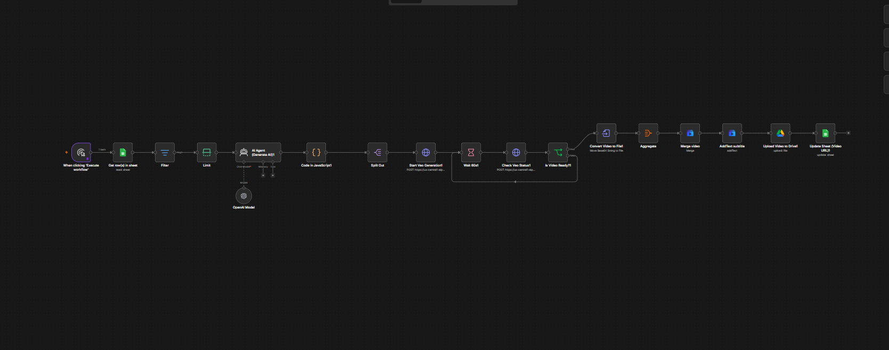

# AI Long-Form Video Generator (Veo 3.1 Multi-Scene)

**Platform:** n8n **Category:** AI Content / Video Production

## Overview

Veo creates only short clips, but ads need around 30 seconds. This workflow turns one topic from a Google Sheet into a complete marketing package (script, title, description, hashtags), then generates a 4-scene video and stitches it into a single 30-second ad with subtitles.

## How It Works

1. Trigger — manual run (or Google Sheets trigger) picks the next unprocessed row.
2. A GPT-4o agent acting as a creative director writes the ad script, SEO metadata, an image prompt, and 4 scene-by-scene Veo prompts as strict JSON.
3. Gemini 2.5 Flash Image (Vertex AI) generates a thumbnail, which is uploaded to Google Drive.
4. Each scene prompt is sent to Veo 3.1. The workflow polls the long-running operation until the video is ready.
5. All clips are aggregated, merged into one video, and given a subtitle call-to-action.
6. The final video is uploaded to Drive and the sheet row is updated with the text, image and video URLs.

## Tech Stack

n8n, OpenAI (GPT-4o), Google Vertex AI (Veo 3.1, Gemini 2.5 Flash Image), Google Sheets, Google Drive, MediaFX

## Key Features

- Multi-scene storytelling: each scene is a separate Veo generation, merged into one video
- Strict-JSON prompting with a cleanup parser for reliable structured output
- Async polling loop for Veo's long-running operations
- Google Sheet works as a simple content queue and status tracker

## Setup

1. Import `workflow.json`.
2. Install the MediaFX community node (`n8n-nodes-mediafx`) for merging video and adding subtitles.
3. Connect credentials: OpenAI, Google (OAuth2 with Vertex AI access), Google Sheets, Google Drive.
4. Replace placeholders: `{{GCP_PROJECT_ID}}`, `{{SHEET_ID}}`, `{{DRIVE_IMAGE_FOLDER_ID}}`, `{{DRIVE_VIDEO_FOLDER_ID}}`.
5. Sheet columns: `Topic`, `Ad Script`, `FB/YT Title`, `Description`, `Keywords`, `Hashtags`, `Post Date`, `Comments`, `ImageURLs`, `VideoURLs`.

## Data Privacy

All personal, client, and employer data has been removed and replaced with placeholders. Company names, phone numbers, and email addresses shown here (e.g. "Northwind AI Call Solutions") are fictional and do not refer to real businesses or people.

---

Built by **Tahjib Hossain (Leon)**
