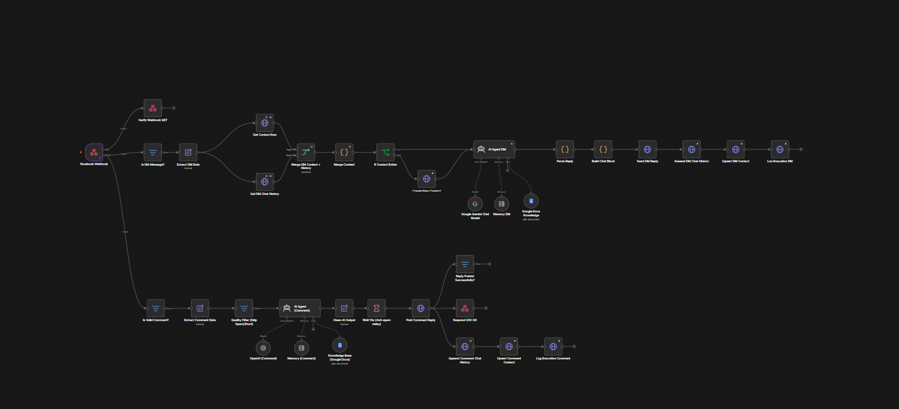

# Facebook & Instagram DM + Comment AI Auto-Reply

**Platform:** n8n **Category:** AI Chatbot / Lead Capture

## Overview

Businesses miss leads when Facebook comments and DMs go unanswered. This workflow replies to public comments and private messages (Facebook and Instagram) with AI, qualifies the visitor, collects their contact details, and logs everything to a Supabase CRM.

## How It Works

1. Trigger — Meta webhook receives comment and DM events (GET request handles webhook verification).
2. Comments: filter out spam and one-word replies, generate a short public reply with GPT-4o-mini using a Google Docs knowledge base, wait 10s, then post it via the Graph API.
3. DMs: look up the contact and full chat history in Supabase and merge them into one context.
4. A Gemini-powered agent replies, works through a checklist (phone → name → email → booking link), and returns structured JSON.
5. The reply is parsed, sent back through the Messenger API, and the contact record is created or updated.
6. Every conversation and execution is logged to Supabase.

## Tech Stack

n8n, Meta Graph API (Facebook / Instagram), OpenAI, Google Gemini, Google Docs, Supabase

## Key Features

- Handles both public comments and private DMs from a single webhook
- Spam and low-value comment filtering, plus an anti-spam delay before posting
- Lead-qualification agent with memory that never asks the same question twice
- Structured JSON output for interest level, CRM summary, and extracted contact fields
- Booking link is sent only once per contact (checked against chat history)

## Setup

1. Import `workflow.json`.
2. Connect credentials: OpenAI, Google Gemini, Google Docs, Header Auth (Supabase).
3. Replace placeholders: `{{FACEBOOK_PAGE_ACCESS_TOKEN}}`, `{{SUPABASE_PROJECT_ID}}`, `{{SUPABASE_API_KEY}}`, `{{GOOGLE_DOC_ID}}`, `{{BOOKING_SLUG}}`.
4. Create Supabase tables `contacts`, `chat_messages` and `workflow_executions`, then point your Meta app webhook to the `facebook-webhook` path.

## Data Privacy

All personal, client, and employer data has been removed and replaced with placeholders. Company names, phone numbers, and email addresses shown here (e.g. "Northwind Digital Solutions") are fictional and do not refer to real businesses or people.

---

Built by **Tahjib Hossain (Leon)**
