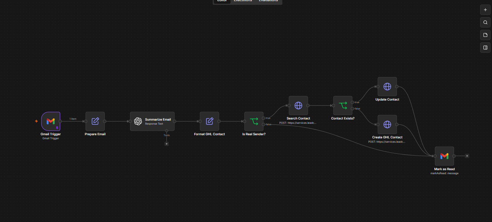

# Gmail to GoHighLevel AI Contact Sync

**Platform:** n8n **Category:** CRM Sync / Lead Management

## Overview

Leads that arrive by email often never make it into the CRM. This workflow watches a Gmail inbox, uses GPT-4o to pull the lead's details out of each real customer email, and creates or updates the matching contact in GoHighLevel with an AI summary.

## How It Works

1. Trigger — Gmail polls every minute for unread emails, excluding no-reply, notification, and bounce senders.
2. A second filter double-checks the sender, so only real people get through.
3. GPT-4o extracts name, phone, address, urgency, service request, and a short summary as strict JSON.
4. The data is formatted and GoHighLevel is searched for an existing contact by email.
5. If found, the contact is **updated**. If not, a new contact is **created**, tagged `Email Lead`, with an AI summary custom field.
6. The email is marked as read so it's never processed twice.

## Tech Stack

n8n, Gmail, OpenAI (GPT-4o), GoHighLevel API (LeadConnector)

## Key Features

- Two-layer filter that blocks automated senders
- AI extraction that never invents data (missing fields stay empty)
- Upsert logic: search, then update or create, with no duplicate contacts
- AI summary (urgency, service, summary) written to a GHL custom field for fast follow-up

## Setup

1. Import `workflow.json`.
2. Connect credentials: Gmail, OpenAI.
3. Replace placeholders: `{{GHL_API_KEY}}` (Private Integration token), `{{LOCATION_ID}}`.
4. Create a GHL contact custom field with the key `ai_sms_summary`.

## Data Privacy

All personal, client, and employer data has been removed and replaced with placeholders. Company names, phone numbers, and email addresses that appear in this workflow are fictional and do not refer to real businesses or people.

---

Built by **Tahjib Hossain (Leon)**
