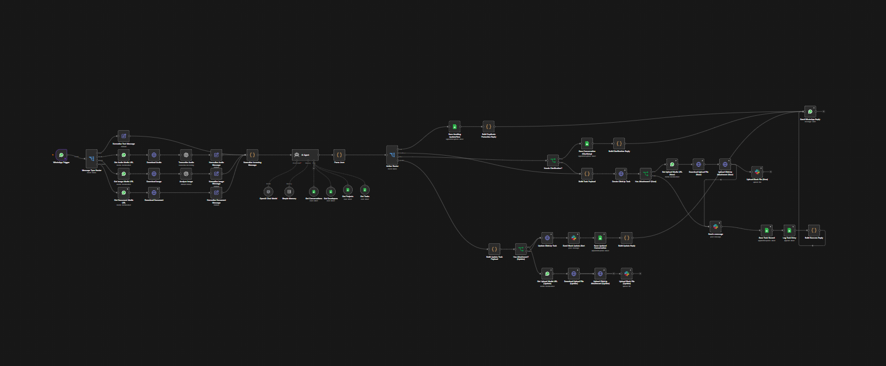

# WhatsApp Client Task Intake to ClickUp & Slack

**Platform:** n8n **Category:** AI Agent / Project Management

## Overview

Agencies receive bug reports and change requests from clients over WhatsApp, and they get lost in chat. This AI intake assistant understands each message (text, voice note, screenshot, or document), asks clarifying questions when needed, and turns it into a properly assigned ClickUp task with a Slack alert.

## How It Works

1. Trigger — the WhatsApp Business webhook receives the client message, and a router branches by type: text, audio, image, or document.
2. Voice notes are transcribed (Whisper), and screenshots are analyzed with GPT-4o Vision. Everything becomes plain text.
3. An AI agent with memory checks the client's projects, previous conversations, and the developer list (Google Sheets tools) to classify intent, priority, and assignee.
4. If details are missing, it asks the client a clarifying question. If a similar open issue exists, it asks whether to update that task or open a new one (duplicate protection).
5. Creates or updates the ClickUp task with tags, priority, and assignees, and uploads any attachment.
6. Posts to Slack, logs the task to Sheets, and confirms back to the client on WhatsApp.

## Tech Stack

n8n, WhatsApp Business Cloud API, OpenAI (GPT-4o-mini, GPT-4o Vision, Whisper), ClickUp API, Slack, Google Sheets

## Key Features

- Multi-modal intake: text, voice, images, and documents
- Conversation state machine (clarifying, awaiting update/new, task created) stored per phone number
- Duplicate protection: asks before opening a second task for the same issue
- Role-based auto-assignment from a developer roster sheet
- Attachments forwarded to ClickUp and Slack automatically

## Setup

1. Import `workflow.json`.
2. Connect credentials: WhatsApp (API + Trigger), OpenAI, Slack, Google Sheets.
3. Replace placeholders: `{{SHEET_ID}}`, `{{CLICKUP_API_KEY}}`, `{{SLACK_TEAM_ID}}`, `{{CHANNEL_ID}}`.
4. Create sheet tabs: `clients_projects` (phone, project, `clickup_list_id`), `conversations`, `developers`, and `task_logs`.

## Data Privacy

All personal, client, and employer data has been removed and replaced with placeholders. Company names, phone numbers, and email addresses that appear in this workflow are fictional and do not refer to real businesses or people.

---

Built by **Tahjib Hossain (Leon)**
